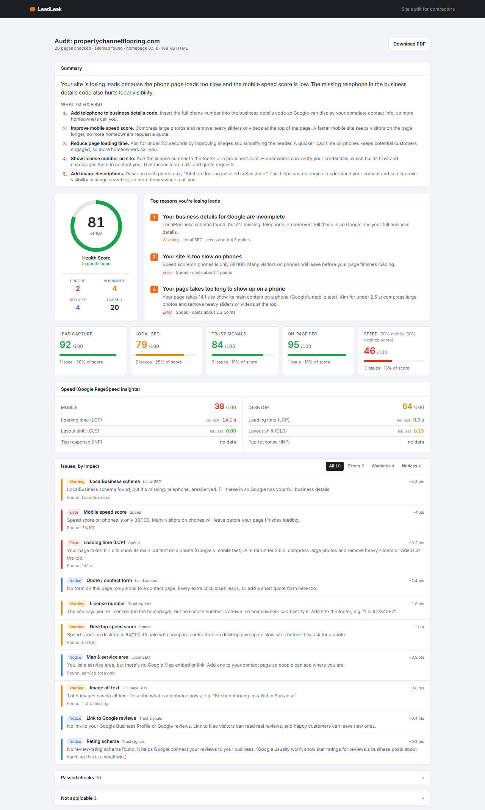
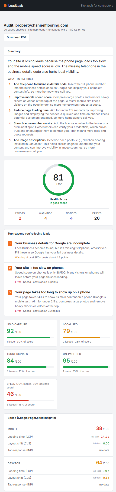

# LeadLeak: local SEO & lead audit for contractors

LeadLeak checks a contractor's website (roofers, flooring installers, plumbers, HVAC, remodelers) and explains **why the site is losing calls and quote requests**: a 0–100 Health Score, a prioritized list of issues, and a plain-English written report you can download as a PDF.

**Live demo:** _link added after deployment_ · **Sample report:** [docs/sample-report.pdf](docs/sample-report.pdf)



<details>
<summary>Mobile view</summary>



</details>

## What it checks

| Category | Examples |
| --- | --- |
| **Lead capture** | Tap-to-call phone link at the top, quote/contact form (and how many fields), "Free estimate" button above the fold |
| **Local SEO** | LocalBusiness schema and its fields, city and service pages (from the sitemap and links), same name/address/phone across the site, map and service area |
| **Trust signals** | Reviews and testimonials, license number, "licensed & insured", warranty, project gallery, BBB and trade badges, Google reviews link |
| **On-page SEO** | Title, meta description, H1/H2, image alt text, canonical, noindex, Open Graph, word count, internal links |
| **Speed** | Google PageSpeed Insights for mobile and desktop: score, loading time (LCP), layout shift (CLS), tap response (INP) |

It crawls the homepage plus up to 20 pages (sitemap first), respects `robots.txt`, and detects whether the site is a contractor, an online store or something else. Contractor-only checks are marked N/A on other sites, so the score stays fair.

## How the score works

- Every check has a weight and a status: Passed = 100%, Notice = 75%, Warning = 40%, Error = 0%. N/A checks don't count.
- Category weights: **Lead capture 30%**, Local SEO 25%, Trust 15%, On-page 15%, Speed 15%. If a category has nothing to score, its share goes to the others; a category with only one scored check counts half.
- The Speed category is Google's own speed score, mixed **70% mobile + 30% desktop**, so it matches what clients see in PageSpeed Insights.
- Each issue shows how many points it costs the Health Score (`−4.3 pts`). The costs add up to exactly what's missing from 100, so the list is sorted by real impact.

## The written report (and how it's kept honest)

The AI summary is written by Groq from a short summary of the audit results (never the page HTML). Because a wrong statement in a client report is worse than no summary, every report is checked before it's shown:

- **Facts only:** numbers must appear in the audit data, and it may not suggest fixing something that already passed (e.g. "make your phone tap-to-call" when it already is).
- **Plain English:** no jargon (LCP, schema, H1…), and every fix must say how it brings more calls or quote requests.
- If a check fails, the model is asked once to rewrite it. If a factual problem remains, the summary is dropped and the rule-based "Top reasons" are shown instead.

## Tech stack

Next.js 16 (App Router, Route Handlers) · TypeScript · Tailwind CSS v4 · cheerio · Google PageSpeed Insights API · Groq API · @react-pdf/renderer · Vitest (231 tests) · Vercel

## How it works

```
Browser                       Server (Route Handlers)
  │  POST /api/audit  ───────►  fetch homepage safely → crawl ≤20 pages → run checks   (~5 s)
  │  ◄── dashboard shows right away
  │  POST /api/speed  ───────►  PageSpeed Insights, mobile + desktop in parallel       (20–60 s)
  │  POST /api/report ───────►  Groq report + accuracy review                         (~2 s)
  │  Download PDF: built in the browser with react-pdf
```

- `lib/fetchPage.ts`: safe fetching (timeouts, 3 MB limit, redirect checks, blocks localhost and private IPs).
- `lib/checks/*`: the checks, all pure functions with unit tests (no network).
- `lib/score.ts`: scoring, issue impact and "Top reasons".
- `lib/aiReport.ts`: prompt, accuracy review and plain-English cleanup.
- Recent audits are saved in the browser for 24 hours, so running the same site again doesn't use the free API quotas.

## Run it locally

```bash
git clone https://github.com/Rafy987/seo-audit-tool.git
cd seo-audit-tool
npm install
cp .env.example .env.local   # then add your own keys
npm run dev                  # http://localhost:3000
npm test                     # unit tests
```

### Environment variables

| Name | Required | What it's for |
| --- | --- | --- |
| `PAGESPEED_API_KEY` | Yes | Google PageSpeed Insights (free key from Google Cloud Console → APIs & Services → Credentials) |
| `GROQ_API_KEY` | Yes | Written report (free key from console.groq.com) |
| `GROQ_MODEL` | No | Groq model, default `openai/gpt-oss-20b` |
| `PREPARED_BY_NAME`, `PREPARED_BY_EMAIL`, `PREPARED_BY_URL` | No | "Prepared by" block at the end of the PDF |

Both API keys are free and need no credit card. Keys live only in `.env.local` (git-ignored) or the hosting provider's settings.

## Limits and protections

- Per visitor per hour: 10 audits, 15 speed tests, 20 written reports. App-wide daily caps protect the free API quotas.
- Long-running work has time limits (homepage 10 s, crawl 25 s, speed test 55 s).

## Honest limits

- **Name, address and phone are checked only inside the website.** Checking Google Business Profile or Yelp needs paid APIs.
- **No Google review count** for the same reason; only review signals on the site itself.
- Up to 20 pages are checked. Content loaded later by JavaScript (some galleries, review widgets, forms) may be missed.
- "Above the fold" is an estimate: static HTML has no screen size.
- City pages are found from URL patterns and city names on the site, so unusual URLs can be missed.
- Rate limits and the server cache are in memory, and each Vercel instance has its own, so real limits can be a little higher. The browser cache only works in the same browser.
- Google's speed test is sometimes very slow for a site; if it times out, Speed is left out of the score and can be retried.
- Some sites block automated visits; LeadLeak shows a clear error when that happens.
